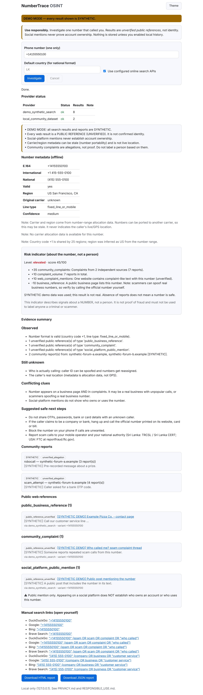

# NumberTrace OSINT

**Privacy-respecting unknown-caller investigation.** Enter **one** phone number that called you.
NumberTrace checks offline number metadata, your own community-report dataset, and (optionally)
documented web-search APIs. It then writes an evidence report that keeps **facts, hints and
unverified allegations clearly separate**.

> NumberTrace does **not** reveal who owns a number. Caller ID can be spoofed and numbers get
> reassigned. Every web result is labelled `public_reference_unverified`.


<sub>Screenshot of the real running dashboard in `--demo` mode. All results shown are SYNTHETIC.</sub>

## Feature matrix

| Feature | Works with no key / offline | Needs an official API key + internet | Not supported (privacy/legal) |
|---|:-:|:-:|:-:|
| Parse/validate E.164 + national formats (`phonenumbers`) | ✅ | | |
| Region, original carrier, line type, time zone (with portability warning) | ✅ | | |
| Search variants (E.164, international, national, digits…) capped | ✅ | | |
| Manual search links (DuckDuckGo, Google, Bing, Brave) | ✅ (you click) | | |
| Local community-report dataset (JSON you maintain) | ✅ | | |
| Transparent risk indicator with reasons and uncertainty | ✅ | | |
| HTML + JSON report with provenance and timestamps | ✅ | | |
| Web search: **Brave Search API** | | ✅ | |
| Web search: Google Programmable Search JSON API (legacy; Google says it stops 2027-01-01) | | ✅ existing customers | |
| Bing Web Search API | | | ❌ retired by Microsoft (Aug 2025) |
| Scraping search-engine result pages | | | ❌ breaks terms |
| Social account owner lookup (contact sync, reset probes) | | | ❌ |
| Name / home address / live location / family | | | ❌ |
| Breached data, data brokers, people-search sites | | | ❌ (filtered out of results) |
| Bulk / range enumeration | | | ❌ one number per action |

Architecture: [docs/ARCHITECTURE.md](docs/ARCHITECTURE.md) · API: [docs/API.md](docs/API.md) ·
Providers: [docs/PROVIDERS.md](docs/PROVIDERS.md)

## Quickstart

### Kali Linux / Debian / Ubuntu (x86_64 or ARM, Chromebook OK)
Tamil step-by-step guide: **[docs/KALI_SETUP_TAMIL.md](docs/KALI_SETUP_TAMIL.md)** ·
Problems: [docs/KALI_TROUBLESHOOTING.md](docs/KALI_TROUBLESHOOTING.md)

```bash
sudo apt update && sudo apt install -y git python3 python3-venv
```
```bash
git clone https://github.com/rknagilan/numbertrace-osint.git
```
```bash
cd numbertrace-osint
```
```bash
bash scripts/install_kali.sh          # light CLI. Use --web for dashboard, --dev for tests
```
```bash
source .venv/bin/activate
```
```bash
numbertrace doctor
```

No `sudo pip`, no `--break-system-packages`: everything goes into the project's `.venv`.

### macOS
```bash
python3 -m venv .venv && source .venv/bin/activate && pip install -e ".[web]"
```

### Windows 11 (PowerShell)
```powershell
powershell -ExecutionPolicy Bypass -File scripts\install_windows.ps1 -Web
.\.venv\Scripts\Activate.ps1
numbertrace doctor
```

## Usage

```bash
numbertrace normalize +94771234567                      # validate + normalize (offline)
numbertrace normalize 0771234567 --country LK           # Sri Lanka national format
numbertrace inspect --number '+14155550100' --offline   # metadata + manual links, no network
numbertrace search --number '+94771234567'              # full investigation (uses APIs if configured)
numbertrace search --number '+94771234567' --offline --export   # writes reports/*.html + *.json
numbertrace demo                                        # SYNTHETIC demo, safe to show anyone
numbertrace providers                                   # what is configured
numbertrace --light search -n '+94112345678' --offline  # plain output for slow terminals
numbertrace serve                                       # dashboard at http://127.0.0.1:8765 (needs [web])
numbertrace history clear                               # delete opt-in history
```
`+94771234567` / `+94112345678` are **illustrative** (the `phonenumbers` library's example numbers);
`+1 415 555 01xx` numbers are reserved for fiction. No real person is involved.

### Example: offline Sri Lanka check (real output, trimmed)
```text
$ numbertrace --light normalize 0771234567 --country LK
│ E.164            │ +94771234567    │
│ International    │ +94 77 123 4567 │
│ National         │ 077 123 4567    │
│ Valid / Possible │ yes / yes       │
│ Region           │ LK Sri Lanka    │
│ Original carrier │ Dialog          │
│ Line type        │ mobile          │
│ Time zones       │ Asia/Colombo    │
│ Confidence       │ medium          │
Search variants: +94771234567 | +94 77 123 4567 | 077 123 4567 | 0771234567
Warning: Interpreted as a national number for region LK. If the call came from
abroad, re-enter it with its +country code.
Note: Carrier and region come from number-range allocation data. Numbers can be
ported to another carrier, so this may be stale. It never indicates the caller's
live/GPS location.
```

### Example: demo (SYNTHETIC results, real output, trimmed)
```text
$ numbertrace --light demo
! DEMO MODE: all search results and reports are SYNTHETIC.
│ demo_synthetic_search   │ ok     │ 8       │ 6       │      │
│ local_community_dataset │ ok     │ 2       │ 0       │      │
│ Level: elevated (score 45/100)                                               │
│ +35  community_complaints: Complaints from 2 independent sources (7 reports) │
│ +10  complaint_volume: 7 reports in total.                                   │
│ +10  web_complaint_mentions: One website contains complaint-like text ...    │
│ -10  business_reference: A public business page lists this number ...       │
community_complaint (1) - public_reference_unverified
  - [SYNTHETIC DEMO] Who called me? spam complaint thread
social_platform_public_mention (1) - public_reference_unverified
  - [SYNTHETIC DEMO] Public post mentioning the number
    Public mention only. Appearing on a social platform does NOT establish who
owns an account or who uses this number.
```

## Configuration
Copy `.env.example` to `.env` (the installer does this). Everything is optional:

| Variable | Default | Meaning |
|---|---|---|
| `NUMBERTRACE_DEFAULT_REGION` | `LK` | Region for national-format numbers |
| `NUMBERTRACE_BRAVE_API_KEY` | – | Enables live Brave web search |
| `NUMBERTRACE_GOOGLE_CSE_KEY` / `_CX` | – | Legacy Google CSE (existing customers) |
| `NUMBERTRACE_MAX_VARIANTS` | 4 (max 12) | Number text variants |
| `NUMBERTRACE_MAX_QUERIES` | 6 (max 20) | Query budget per investigation, shared by providers |
| `NUMBERTRACE_PROVIDER_TIMEOUT` | 15 s | Per-provider timeout (partial results are kept) |
| `NUMBERTRACE_API_RATE_LIMIT_PER_MINUTE` | 10 | Dashboard/API rate limit |
| `NUMBERTRACE_INCLUDE_DOMAINS` / `_EXCLUDE_DOMAINS` | – | Comma-separated domain filters |
| `NUMBERTRACE_COMMUNITY_DATASET` | – | Path to your community-reports JSON |
| `NUMBERTRACE_HISTORY` | 0 | Opt-in masked local history |

## How the risk indicator works
It is a sum of **visible weighted reasons**: format anomaly, premium-rate/VoIP range,
complaints (1 source = +15, 2 or more independent sources = +35), complaint volume, complaint-like
web pages, and a business listing (−10). It reaches **elevated** only when two independent kinds
of evidence agree. One complaint can never make it elevated. With no data it reports
`insufficient_data`, never "safe". It describes a **number**, never a person.

## Development
```bash
pip install -e ".[dev]"
ruff check numbertrace tests && ruff format --check numbertrace tests
mypy
pytest --cov=numbertrace
```
Measured results are in [docs/TEST_RESULTS.md](docs/TEST_RESULTS.md).

## Known limitations
- Carrier data is the **original allocation**. Ported numbers show the old carrier.
- Spoofed caller IDs make every lookup about the *displayed* number, not the real caller.
- No free spam-reputation API with clear licence terms was found, so only a local dataset
  adapter ships. `ReputationProvider` is ready for a licensed source.
- Web-result categories come from domain lists and keywords, so a result can be miscategorised.
- PDF export: use the browser's *Print → Save as PDF* on the HTML report.
- Rate limiting is in-memory (single process), which suits a local tool.
- The CI Kali job runs in a `kali-rolling` container on x86_64. It was **not** tested on real Kali
  hardware or an ARM Chromebook (the pure-Python dependencies should work there).

## Future ideas
Additional documented search providers (Mojeek, etc.), a licensed reputation adapter, Tamil/Sinhala UI
localisation, signed release wheels, and an optional SQLite history with encryption.

## Licence
**MIT**. Chosen over Apache-2.0 because it is short and easy for beginners and contributors to
understand. The trade-off: MIT has no explicit patent grant, which Apache-2.0 provides. For a small
OSINT utility with no patent concerns, simplicity wins. See [LICENSE](LICENSE), plus
[SECURITY.md](SECURITY.md), [PRIVACY.md](PRIVACY.md), [RESPONSIBLE_USE.md](RESPONSIBLE_USE.md),
[CONTRIBUTING.md](CONTRIBUTING.md) and [CODE_OF_CONDUCT.md](CODE_OF_CONDUCT.md).
